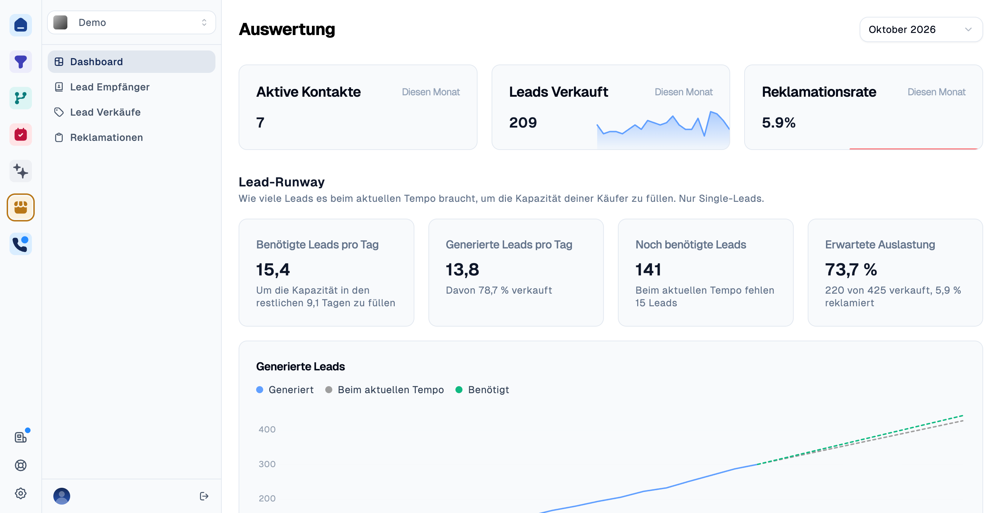

## Überblick

Das Dashboard unter **Direct → Dashboard** (Seitentitel: **Auswertung**) zeigt Ihnen den aktuellen Stand Ihres Lead-Verkaufs. Oben rechts wählen Sie den Monat, alle Bereiche zeigen dann diesen Monat.

Wie jede Zahl berechnet wird, lesen Sie unter [Wie werden die Kennzahlen berechnet?](/direct/dashboard/kennzahlen).

---

## Kennzahlen

Oben stehen drei Kacheln, jeweils für den gewählten Monat:

| Kachel | Bedeutung |
|---|---|
| **Aktive Kontakte** | Anzahl der aktiven [Käufer](/direct/kaeufer/anlegen), die Single-Leads annehmen und ein monatliches Single-Lead-Limit größer 0 haben |
| **Leads Verkauft** | Anzahl der im Monat an diese Käufer verkauften Leads (erstattete Verkäufe ausgenommen) |
| **Reklamationsrate** | Anteil der im Monat genehmigten [Reklamationen](/direct/reklamationen/index) an den Verkäufen des Monats |

Verkäufe an deaktivierte Käufer zählen in keiner Kachel.

---

## Lead-Runway

Die Lead-Runway zeigt, wie viele Leads Sie beim aktuellen Tempo noch generieren müssen, um die Kapazität Ihrer Käufer bis zum Monatsende zu füllen. Sie berücksichtigt die Tageslimits und die Urlaube Ihrer Käufer im laufenden Monat. Für einen vergangenen Monat zeigt sie, wie viele Leads gefehlt haben. Details unter [Lead-Runway](/direct/dashboard/kennzahlen#lead-runway).

---

## Lead Verteilung

Zwei Hinweiszeilen zeigen, wie viele Käufer ihr Tages- bzw. Monats-Limit bereits erreicht haben – relevant für die [automatische Verteilung](/direct/konfiguration/verkauf), da diese Käufer bis zur nächsten Periode keine weiteren Leads mehr automatisch zugeteilt bekommen.

---

## Lead Verteilungs-Analyse

Der Chart zeigt je Käufer die Ziel-Kapazität (monatliches Single-Lead-Limit) im Vergleich zu den heute sowie den im Monat bereits zugeteilten Leads – sortiert nach Auslastung, sodass über- und unterversorgte Käufer schnell auffallen. Urlaubstage zählen dabei wie bereits gefüllte Tage, siehe [Auslastung](/direct/dashboard/kennzahlen#auslastung).

---

## Häufige Fragen

<AccordionGroup>
  <Accordion title="Zählt ein erstatteter Verkauf noch als 'Leads Verkauft'?">
    Nein, erstattete Verkäufe werden bei der Kennzahl "Leads Verkauft" nicht mitgezählt.
  </Accordion>
</AccordionGroup>
