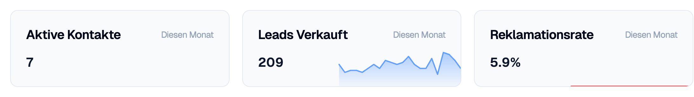
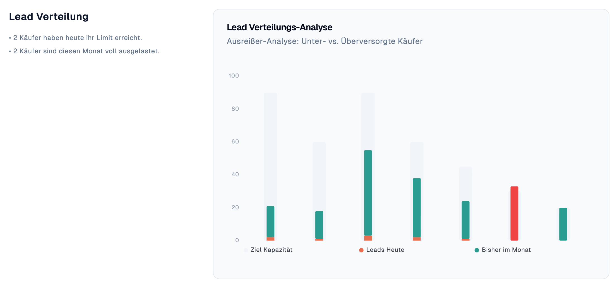
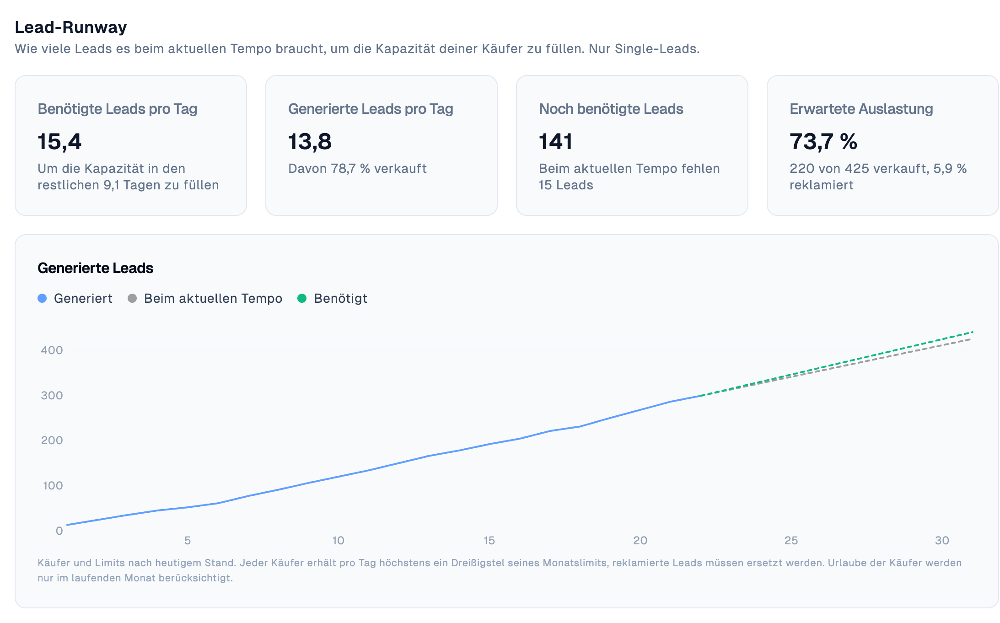
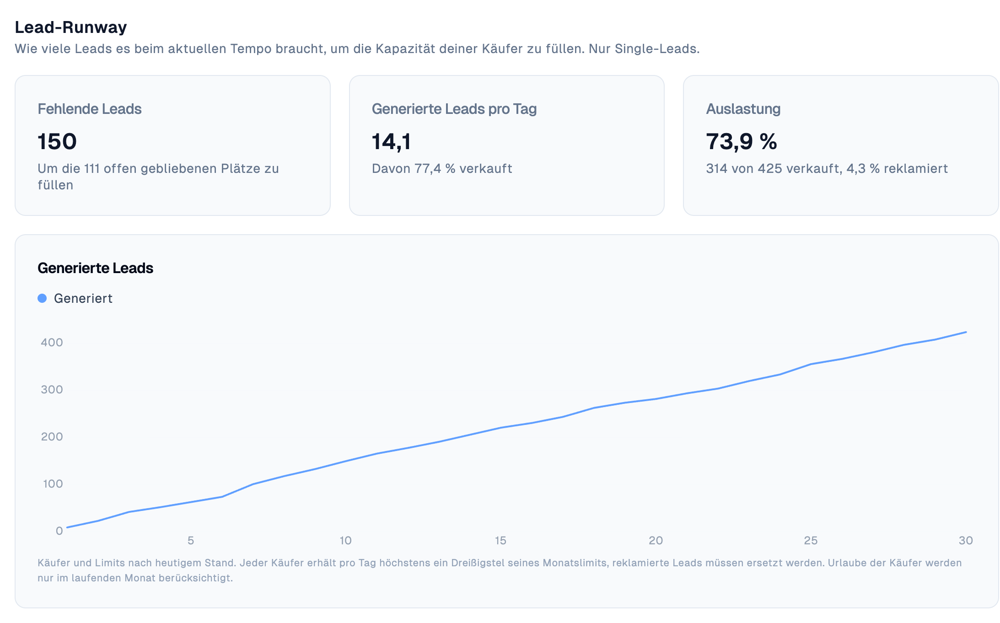

## Grundlagen

Die [Auswertung](/direct/dashboard/index) rechnet nach denselben Regeln wie die [automatische Verteilung](/direct/konfiguration/verkauf). Die Zahlen zeigen Ihnen also, was die Verteilung tatsächlich mit Ihren Leads macht.

Für alle Kennzahlen gilt:

- **Monate laufen in UTC**, wie die automatische Verteilung. Ein Monat beginnt am 1. um 00:00 Uhr UTC, in Deutschland also um 01:00 Uhr (Winterzeit) oder 02:00 Uhr (Sommerzeit).
- **Käufer und Limits nach heutigem Stand**, auch für vergangene Monate. Frühere Limits werden nicht gespeichert.
- **Nur Single-Leads füllen die Kapazität.** Als Kapazität eines Käufers zählt sein monatliches Limit für Single-Leads. Multi-Leads, die ein Käufer erhalten hat, zählen trotzdem gegen dieses Limit, genau wie bei der automatischen Verteilung.
- **Reklamierte Leads geben ihren Platz frei.** Ein Verkauf mit genehmigter [Reklamation](/direct/reklamationen/index) zählt nicht mehr gegen das Limit des Käufers.
- **Deaktivierte Käufer zählen nirgends.** Verkäufe an Käufer, die Sie deaktiviert haben, fließen in keine Kennzahl ein.
- **Das Tageslimit** eines Käufers ist ein Dreißigstel seines Monatslimits, aufgerundet. Bei einem Monatslimit von 45 sind das 2 Leads pro Tag.

---

## Welche Käufer zählen?

Die automatische Verteilung beliefert nur Käufer, die Single-Leads annehmen (**Single** oder **Beides**) und ein monatliches Single-Lead-Limit von mindestens 1 haben. Nur diese Käufer erscheinen in der Auswertung.

| Bereich | Welche dieser Käufer zählen |
|---|---|
| **Aktive Kontakte** und **Lead Verteilung** | Nur aktive Käufer, also die, an die die Verteilung gerade verkauft |
| **Lead-Runway** | Aktive und pausierte Käufer, denn pausierte Käufer erhalten nach ihrer Rückkehr wieder Leads. Ein Käufer, der den ganzen Monat pausiert ist, zählt nicht. |

---

## Kennzahlen oben



| Kachel | So wird gerechnet |
|---|---|
| **Aktive Kontakte** | Anzahl der aktiven Käufer, die die Verteilung beliefert |
| **Leads Verkauft** | Summe der Verkäufe an diese Käufer im Monat, ohne Verkäufe mit genehmigter Reklamation. Der Verlauf darunter zeigt alle Verkäufe je Tag. |
| **Reklamationsrate** | Im Monat genehmigte Reklamationen ÷ im Monat getätigte Verkäufe × 100. Maßgeblich ist bei der Reklamation das Datum der Prüfung, beim Verkauf das Verkaufsdatum. |

---

## Lead Verteilung



### Limit erreicht

- **Tageslimit erreicht:** Ein Käufer hat heute so viele Leads erhalten, wie sein Tageslimit erlaubt. Diese Zeile erscheint nur für den laufenden Monat.
- **Voll ausgelastet:** Ein Käufer hat im Monat so viele Leads erhalten, wie sein Monatslimit erlaubt.

Beide Käufergruppen erhalten bis zum nächsten Tag bzw. Monat keine weiteren Leads aus der automatischen Verteilung.

### Auslastung

Die **Lead Verteilungs-Analyse** zeigt je Käufer die **Ziel Kapazität** (sein Monatslimit), die **Leads Heute** und die Leads **Bisher im Monat**. Die Käufer sind nach Auslastung sortiert, der am wenigsten ausgelastete steht vorne. In derselben Reihenfolge wählt die automatische Verteilung, wer den nächsten Lead erhält.

Die Auslastung berechnet sich so:

```
Auslastung = Leads im Monat ÷ Monatslimit  +  Urlaubstage im Monat ÷ 30
```

Urlaubstage sind die ganzen Tage, die der Käufer in seiner letzten bereits beendeten Pause im laufenden Monat abwesend war. So gilt ein Käufer nach seinem Urlaub nicht als unterversorgt, nur weil er in dieser Zeit keine Leads erhalten konnte. Die Auslastung ist höchstens 100 %.

Hat ein Käufer mehr Leads erhalten als sein Monatslimit, ist sein Balken rot.

<Tip>
**Beispiel:** Ein Käufer mit einem Monatslimit von 30 hat 12 Leads erhalten und war vom 1. bis einschließlich 6. des Monats im Urlaub, also 6 ganze Tage. Seine Auslastung ist 12 ÷ 30 + 6 ÷ 30 = 60 %.
</Tip>

---

## Lead-Runway

Die Lead-Runway beantwortet die Frage: Wie viele Leads müssen Sie noch generieren, um die Kapazität Ihrer Käufer in diesem Monat zu füllen, und reicht Ihr aktuelles Tempo dafür?



### Kapazität

| Größe | So wird gerechnet |
|---|---|
| **Kapazität** | Summe der Monatslimits aller Käufer der Runway |
| **Verkauft** | Leads, die die Käufer im Monat erhalten haben, ohne reklamierte. Je Käufer höchstens bis zu seinem Limit, damit ein überversorgter Käufer keine Lücke bei einem anderen verdeckt. |
| **Offen** | Kapazität − Verkauft |
| **Noch erreichbar** | Der Teil der offenen Kapazität, den die Tageslimits bis zum Monatsende noch zulassen |

**Noch erreichbar** berechnet sich je Käufer:

- Für **heute**: sein Tageslimit abzüglich der Leads, die er heute schon erhalten hat.
- Für **jeden weiteren Tag** bis zum Monatsende: sein volles Tageslimit.
- Insgesamt höchstens so viel, wie bei ihm noch offen ist.

Ein Tag zählt nur, wenn die automatische Verteilung an diesem Tag noch läuft, während der Käufer erreichbar ist. Die Verteilung läuft werktags von 06:00 bis 18:55 Uhr UTC, am Wochenende ab 08:00 Uhr UTC. Nach dem letzten Lauf eines Tages kommt für diesen Tag also nichts mehr hinzu.

### Urlaube

Pausiert ein Käufer im laufenden Monat, zählen seine Urlaubstage bei **Noch erreichbar** nicht mit. Das gilt für eine Pause, die gerade läuft, und für eine geplante Pause später im Monat. Kehrt ein Käufer erst nach dem letzten Lauf eines Tages zurück, zählt dieser Tag ebenfalls nicht.

Sein Monatslimit zählt trotzdem voll zur **Kapazität**, denn auch die automatische Verteilung senkt das Limit für eine Pause nicht. Die **Auslastung** eines Käufers mit Urlaub kann deshalb unter 100 % bleiben, auch wenn ihm alle erreichbaren Leads verkauft wurden.

<Tip>
**Beispiel:** Heute ist der 22. eines Monats mit 31 Tagen. Ein Käufer hat ein Monatslimit von 60 (Tageslimit 2) und 10 Leads erhalten, also sind 50 offen. Ohne Urlaub sind noch 2 Leads heute und 9 × 2 an den Tagen danach erreichbar, zusammen 20. Kehrt er erst am 27. aus dem Urlaub zurück, bleiben nur der 27. bis 31.: 5 × 2 = 10.
</Tip>

### Tempo

| Kachel | So wird gerechnet |
|---|---|
| **Generierte Leads pro Tag** | Im Monat generierte Leads ÷ bisher vergangene Tage, mindestens 1 Tag |
| **Davon … verkauft** | Im Monat als Single-Lead verkaufte Leads ÷ im Monat generierte Leads, höchstens 100 % |
| **Noch benötigte Leads** | Noch erreichbare Plätze × Leads pro Platz, aufgerundet |
| **Benötigte Leads pro Tag** | Noch benötigte Leads ÷ restliche Tage im Monat, mindestens 1 Tag |
| **Erwartete Auslastung** | (Verkauft + Plätze, die das aktuelle Tempo bis Monatsende füllt) ÷ Kapazität |

**Leads pro Platz** gibt an, wie viele generierte Leads im Schnitt einen Platz dauerhaft füllen:

```
Leads pro Platz = 1 ÷ (1 − Reklamationsrate) ÷ Verkaufsquote
```

Nicht jeder generierte Lead wird verkauft (Verkaufsquote), und jeder reklamierte Verkauf muss ersetzt werden (Reklamationsrate). Die Reklamationsrate der Runway bezieht sich nur auf Single-Lead-Verkäufe und wird mit höchstens 90 % angesetzt.

Das aktuelle Tempo wird bis zum Monatsende fortgeschrieben: generierte Leads pro Tag × restliche Tage. Liegt das Ergebnis unter den noch benötigten Leads, zeigt die Kachel, wie viele Leads beim aktuellen Tempo fehlen.

<Tip>
**Beispiel:** Es sind noch 24 Plätze erreichbar. Von 86 generierten Leads wurden 60 verkauft (rund 70 %), 10 % der Verkäufe wurden reklamiert. Ein Platz braucht 1 ÷ 0,9 ÷ (60 ÷ 86) ≈ 1,6 Leads. Noch benötigt werden 24 × 1,6 ≈ 38,2, also 39 Leads.
</Tip>

### Sonderfälle

- **Noch kein Lead generiert:** Die Runway nimmt an, dass jeder Lead verkauft wird.
- **Leads generiert, aber keiner verkauft:** Es ist keine Schätzung möglich, weil sich nicht sagen lässt, wie viele Leads einen Platz füllen. Die Kacheln zeigen dann einen Hinweis statt einer Zahl.
- **Vergangene Monate:** Statt der benötigten Leads zeigt die Runway die **Fehlenden Leads**, also wie viele Leads die offen gebliebenen Plätze gefüllt hätten. Urlaube werden für vergangene Monate nicht berücksichtigt.



---

## Häufige Fragen

<AccordionGroup>
  <Accordion title="Warum zählt ein Multi-Lead gegen das Single-Lead-Limit?">
    Die automatische Verteilung zählt alle Leads, die ein Käufer im Monat erhalten hat, gegen sein Single-Lead-Limit. Die Auswertung rechnet genauso, damit sie zeigt, wann die Verteilung einen Käufer tatsächlich nicht mehr beliefert.
  </Accordion>
  <Accordion title="Warum erscheint ein pausierter Käufer nicht in der Lead Verteilung?">
    Die Lead Verteilung zeigt nur Käufer, an die die automatische Verteilung gerade verkauft. In der Lead-Runway zählt ein pausierter Käufer dagegen mit, mit den Tagen nach seiner Rückkehr.
  </Accordion>
  <Accordion title="Warum senkt ein Urlaub nicht die Kapazität?">
    Die automatische Verteilung senkt das Monatslimit eines Käufers für eine Pause nicht. Nach seiner Rückkehr kann er bis zu seinem vollen Limit beliefert werden, begrenzt durch sein Tageslimit. Die Urlaubstage verringern deshalb nur die noch erreichbaren Plätze und damit die benötigten Leads.
  </Accordion>
  <Accordion title="Warum zeigt ein vergangener Monat andere Käufer als damals?">
    Käufer und Limits werden nach heutigem Stand angezeigt, weil frühere Limits nicht gespeichert werden. Ein Käufer, den Sie seitdem deaktiviert haben, fehlt deshalb auch in vergangenen Monaten.
  </Accordion>
</AccordionGroup>
