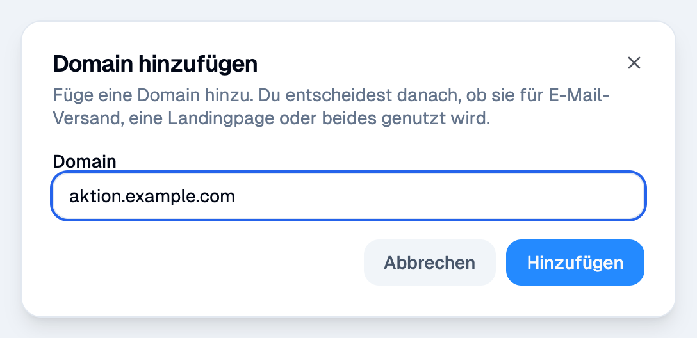
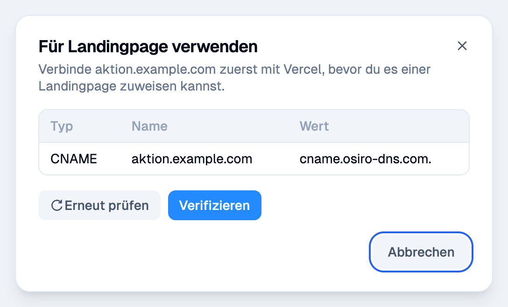
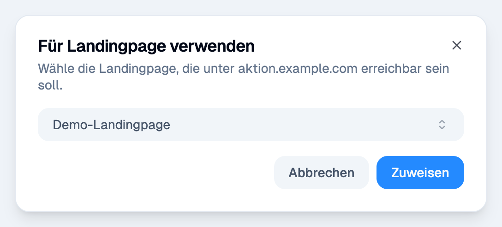
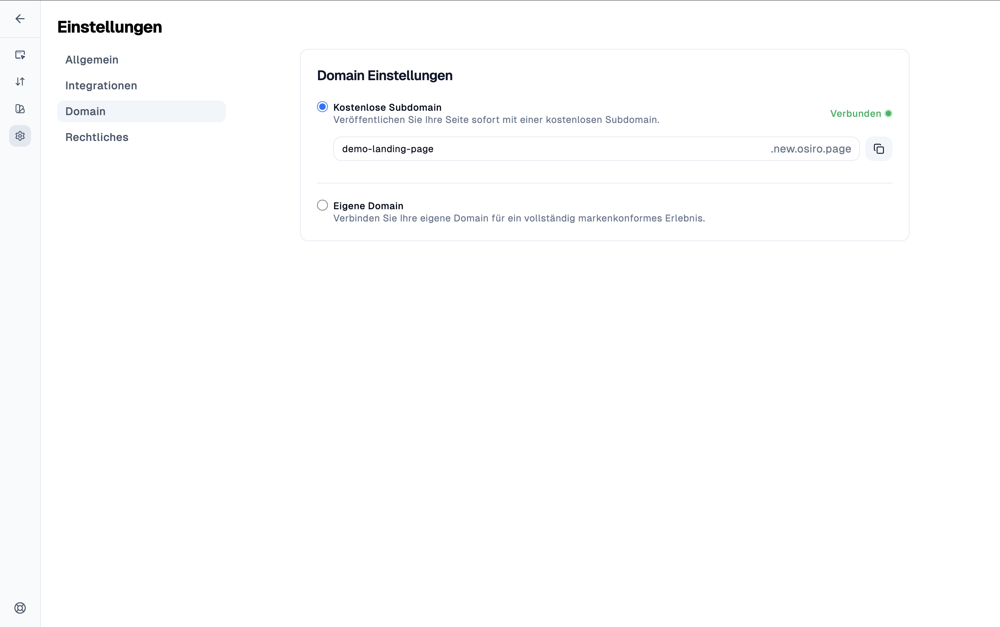

## Bevor Sie anfangen

Sie benötigen Zugriff auf die DNS-Einstellungen Ihrer Domain und auf die gewünschte Organisation in osiro. Wenn Ihre Hauptdomain bereits eine Website anzeigt, verwenden Sie für die Landingpage besser eine freie Subdomain, etwa `aktion.example.com`. So bleibt die bestehende Website unverändert.

Die Screenshots zeigen die osiro-Dialoge mit Beispieldaten.

<Steps>
  <Step title="Domain in osiro hinzufügen">
    Öffnen Sie im Portal **Einstellungen → Organisation → Domains**. Klicken Sie auf **Domain hinzufügen** und geben Sie den gewünschten Hostnamen ein, zum Beispiel `aktion.example.com`. Lassen Sie `https://` und den Seitenpfad weg. Bestätigen Sie mit **Hinzufügen**.

    
  </Step>
  <Step title="Die angezeigten DNS-Einträge übernehmen">
    Öffnen Sie für die Domain die Aktion **Für Landingpage verwenden**. osiro zeigt die erforderlichen DNS-Einträge mit **Typ**, **Name** und **Wert** an. Übernehmen Sie diese bei Ihrem DNS-Anbieter genau so, wie sie für Ihre Domain angezeigt werden.

    

    Für Landingpages in osiro sind das die Standard-Zielwerte. Wählen Sie **eine** der beiden Varianten für den Hostnamen, den Sie verbinden möchten:

    | Gewünschte Adresse | Typ | Name | Zielwert |
    | --- | --- | --- | --- |
    | Hauptdomain, z. B. `example.com` | `A` | `@` (bei manchen Anbietern leer) | `76.76.21.21` |
    | Subdomain, z. B. `aktion.example.com` | `CNAME` | `aktion` (oder die vollständige Subdomain) | `cname.osiro-dns.com.` |

    Wenn Ihr Anbieter keinen Punkt am Ende des CNAME-Ziels akzeptiert, geben Sie `cname.osiro-dns.com` ein. Die Tabelle enthält nur die allgemeinen Zielwerte für Landingpages. Domainspezifische Nachweise zur Inhaberschaft sind davon getrennt.

    Manche Anbieter hängen den Domainnamen automatisch an das Feld **Name** an. Prüfen Sie beim Speichern, dass der vollständige Name nicht doppelt erscheint. Ändern Sie keine Einträge für Ihre bestehende Website oder E-Mail, wenn diese nicht zu der neuen Subdomain gehören.
  </Step>
  <Step title="Domain verifizieren und zuweisen">
    Kehren Sie zu osiro zurück und klicken Sie auf **Erneut prüfen**, sobald Ihre DNS-Änderungen gespeichert sind. Klicken Sie auf **Verifizieren**, wenn osiro die Einträge als korrekt anzeigt. Wählen Sie anschließend unter **Landingpage wählen** die gewünschte Seite und klicken Sie auf **Zuweisen**.

    
  </Step>
  <Step title="Die öffentliche URL prüfen">
    Wenn die Landingpage veröffentlicht ist, öffnen Sie die genaue Adresse über `https://` in einem privaten Browserfenster. Prüfen Sie, ob die richtige Seite lädt. Falls Sie im Editor einen **Pfad** hinterlegt haben, gehört er zur öffentlichen Adresse.
  </Step>
</Steps>

## Wenn die Verifizierung noch aussteht

- **DNS gerade erst gespeichert:** Die Änderung ist möglicherweise noch nicht überall sichtbar. Prüfen Sie später erneut.
- **CNAME wird nicht erkannt:** Falls Ihr DNS-Anbieter einen Proxy für die Subdomain anbietet, stellen Sie den Eintrag zur Prüfung auf **Nur DNS** (bei Cloudflare: graue Wolke).
- **Eintrag nicht gefunden:** Vergleichen Sie Typ, Name und Wert mit der Anzeige in osiro. Prüfen Sie auch, ob Sie die DNS-Zone beim tatsächlich zuständigen Anbieter bearbeiten.
- **DNS stimmt, Verifizierung schlägt weiter fehl:** Wenden Sie sich mit dem Hostnamen und der Fehlermeldung an den osiro-Support. Eventuell ist ein zusätzlicher Nachweis zur Inhaberschaft der Domain erforderlich.
- **Domain bereits zugewiesen:** Prüfen Sie, welche Seite die Domain verwendet, bevor Sie sie verschieben. Links, Anzeigen und QR-Codes können von der bisherigen Adresse abhängen.

<Note>Die Verifizierung für Landingpages ersetzt nicht die separate DNS-Verifizierung für den E-Mail-Versand.</Note>

## Domain im Landingpage-Editor ansehen

Unter [Einstellungen im Landingpage-Editor](/convert/landing-page-editor/einstellungen#domain) finden Sie den Bereich **Domain** für Ihre Seite. Der Screenshot zeigt die Editor-Ansicht, nicht den DNS-Dialog im Portal.

